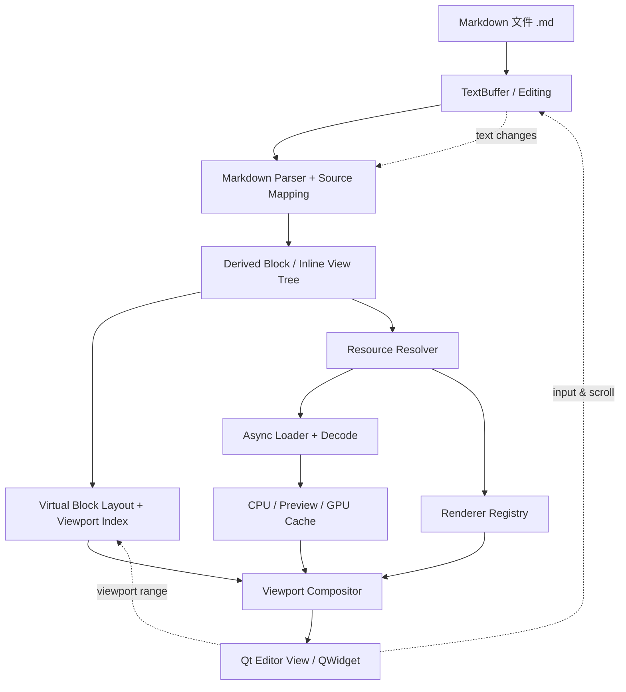

# Qt/C++ 高性能 Markdown 资源文档编辑器架构设计

> 版本：v1.0 · 2026-11-07  
> 定位：Markdown 文本优先、块级语义显示、外部资源引用驱动的原生 Qt/C++ 编辑器  
> 目标平台：Windows / macOS / Linux；建议 Qt 6.x、C++20

## 1. 项目目标与设计原则

开发一个以 `.md` 文件为主文档的高性能编辑器。普通内容以 Markdown 语法存储；图片、表格、CAD 图纸、3D 模型、PDF 等均作为外部资源，以 `` 形式引用。编辑器解析 Markdown 后，为资源引用选择渲染器，在文档内呈现预览；当前以**显示为主，编辑仍以 Markdown 源码为主**，CAD 等高级交互以后通过独立编辑器扩展。

核心约束：

1. **Markdown TextBuffer 是文档内容唯一权威数据源（Source of Truth）**。块树、布局缓存和渲染状态均是可重建的派生数据，不与正文形成双主数据。
2. **资源文件独立存储**。Markdown 只保存 URI/相对路径和少量展示元数据，绝不将大型 DWG/GLB/PDF 二进制直接嵌入文本。
3. **Block 是语义/显示单元，不是 QWidget**。统一视口负责布局、滚动、裁剪、命中测试和绘制；不为每个块创建 QWidget。
4. **编辑、解析、布局、加载、渲染相互解耦**。资源加载不得阻塞 GUI 主线程。
5. **渐进增强**。无扩展能力的 Markdown 查看器仍可读到资源描述和路径；自定义资源预览属于编辑器扩展，不属于标准 Markdown 语义。
6. **先实现高效静态预览，再增加 CAD/3D 的交互**。避免过早构造复杂的插件 ABI 或多 QRhiWidget 体系。

### 1.1 范围

首期目标：Markdown 源码编辑、标题/段落/列表/代码/表格预览、图片、外部 CSV、DXF、GLB、PDF 的只读预览、快速滚动、异步加载、缓存、定位源码。

后续目标：DWG 支持（依赖单独评估的库与许可）、XLSX、资源视图交互、选中 CAD 几何、表格编辑、3D 场景交互、导出与插件扩展。

非目标：第一阶段不做完整 Notion 式结构化富文本编辑器；不实现通用 Markdown 的无损所见即所得编辑；不重写复杂文字排版；不保证普通 Markdown 阅读器能直接渲染 CAD/PDF/GLB。

## 2. 总体架构



### 2.1 模块职责

| 模块 | 职责 | 关键边界 |
|---|---|---|
| TextBuffer | 存储原始 Markdown、编辑、Undo/Redo | **唯一正文权威数据** |
| Markdown Parser | 解析语法、识别 image/link、获取源码范围 | 不能依赖 GUI |
| View Tree | 派生 Heading/Paragraph/List/Table/Resource 节点 | 可重建，不单独保存正文 |
| Source Mapping | 源码 offset 到块、视觉位置与回跳 | 先支持块级定位；所见即所得再扩展细粒度映射 |
| Virtual Layout | 块高度估算、精确布局、可见范围、滚动锚定 | 不进行文件 I/O |
| Resource Resolver | 相对路径、URI、扩展名/MIME/探测、权限与错误处理 | 不承担解码与绘制 |
| Async Loader | 文件读取、格式解析、缩略图/几何预处理 | CPU 工作放后台；GUI 不阻塞 |
| Cache Manager | 资源数据、布局、缩略图、GPU 缓存的预算和淘汰 | 缓存需要可失效 |
| Renderer Registry | 将资源类型/显示模式映射到对应渲染器 | 不持有正文 |
| Render Backend | 文本 QPainter；CAD/3D 可用离屏 QRhi | 遵循 Qt 设备与线程约束 |
| Viewport Compositor | 统一绘制可见块、裁剪和局部重绘 | 不创建海量子 Widget |

## 3. Markdown 资源引用规范

### 3.1 基本语法

推荐优先兼容标准图片语法：

```markdown
# 建筑设计说明

这是首层平面图：


```

**重要约定：**标准 Markdown 中 `` 仅表示图片；将 `.dxf`、`.glb`、`.csv`、`.pdf` 等解释为资源预览，是本编辑器自定义扩展。其他 Markdown 软件可能把它们显示为不可加载的图片。这是可移植性取舍，不能误认为标准行为。

### 3.2 行内与块级资源

- 图片引用**单独占据一个段落**时：提升为 `ResourceBlock`，可呈现 CAD 预览、表格或 PDF 缩略图。
- 图片引用位于段落中间时：优先保留为 `InlineResource`；只支持适合行内排版的资源，如小图片/SVG。大型 CAD/GLB/PDF 在行内时显示图标、名称或链接占位。
- 标准文本链接 `[名称](path)` 保持链接语义，不自动升级为嵌入对象；可以额外提供“预览”操作。

### 3.3 可选显示元数据

可以复用 Markdown 图片可选标题字段，但需要避免覆盖普通 title 文本：

```markdown


```

其中 `mdview:` 是**编辑器私有约定**，不是 Markdown 标准。首版也可以只根据文件类型自动判断；当显示模式需要持久化时，再稳定这个约定。建议将其解析为 `ResourceDisplayOptions`，保留未知选项，允许未来扩展尺寸、页码、缩放等。不要将不可信元数据直接解释为脚本或命令。

### 3.4 路径与安全

- 默认资源路径相对 `.md` 所在目录解析；保存/移动文档时明确处理路径更新。
- 统一规范化 URI，处理 URL 编码、空格、大小写敏感、符号链接及 Windows 路径。
- HTTP(S) 远程资源默认限制下载大小、设置超时与并发预算；可以首版只支持本地文件。
- 对任意外部文件访问、非受信目录、危险扩展名设置明确策略，不执行资源文件携带的脚本/宏。
- 资源解析失败时显示可定位错误信息和原始路径，而不是让文档布局崩溃。

## 4. 文档模型与块模型

### 4.1 核心关系

```text
TextBuffer  ──解析──>  Derived DocumentView
                         ├─ HeadingBlock
                         ├─ ParagraphBlock
                         │   ├─ TextSpan
                         │   ├─ EmphasisSpan
                         │   └─ InlineResource
                         ├─ ListBlock
                         │   └─ ListItemBlock
                         ├─ TableBlock (Markdown 原生表格)
                         └─ ResourceBlock
                             ├─ ResourceRef
                             └─ DisplayOptions
```

注意：Markdown 原生表格的内容来自 TextBuffer，而外部 CSV/XLSX 通过 ResourceBlock 引用。二者可以共享显示层的 TableRenderer，但数据拥有权不同。

### 4.2 核心数据结构（示意）

```cpp
using BlockId = std::uint64_t;

struct SourceRange {
    std::size_t begin = 0;  // 原始 UTF-8 字节偏移，半开区间
    std::size_t end = 0;
};

enum class BlockKind {
    Heading, Paragraph, List, ListItem,
    Code, Quote, Table, Resource, ThematicBreak
};

struct ResourceRef {
    QString originalUri;    // 源 Markdown 中的 URI
    QUrl resolvedUri;       // 解析后统一地址
    QString altText;
    QString displayMode;    // auto / table / chart / 3d ...
};

struct BlockViewNode {
    BlockId id;
    BlockKind kind;
    SourceRange source;
    std::vector<BlockViewNode> children;
    std::optional<ResourceRef> resource;
};
```

**源码偏移必须统一约定**：例如解析器内部以 UTF-8 字节偏移工作，Qt `QString` / `QTextCursor` 常以 UTF-16 代码单元定位。需要一个单独的映射层，避免中文、Emoji 与组合字符导致光标错位。`BlockId` 应尽量在局部编辑后保持稳定，以便复用布局和渲染缓存。

## 5. 核心编辑与增量解析

### 5.1 TextBuffer 选型

- **MVP**：`QTextDocument` / `QPlainTextEdit`，可快速获得选择、输入法、Undo/Redo、基本光标与编辑功能。
- **长期自研**：Piece Table / Rope + 专用编辑视图，可在非常大的文档和复杂预览映射场景下获得更精细控制；但必须自行解决 IME、复杂文本、选择、剪贴板、Undo/Redo、可访问性等问题。
- 不要因为理论复杂度而过早替换 Qt 已经成熟的编辑能力；以实际性能测量为依据。

### 5.2 解析器

- `cmark-gfm` 可以解析 CommonMark/GFM，但**并不直接提供完整的增量解析能力**。
- MVP 可以对小/中等文档采用防抖式全文解析与解析结果缓存；后台解析快照必须带版本号，过期结果不可应用。
- 进阶做法：追踪编辑影响的语法边界（如列表、围栏代码块、引用），按区域重新解析并合并受影响块；需要严格测试跨段落语法改变。
- 解析结果需要保留源码范围，以支持点击预览跳回 `.md` 源码。

### 5.3 编辑模式

首选**源码编辑 + 预览**，可以提供分屏、切换、同视口混合预览。首期不必完成隐藏 Markdown 标记后的细粒度 WYSIWYG 光标模型。独立预览侧的块点击可以直接跳到源码对应位置。

## 6. 资源解析与渲染器注册

### 6.1 标准资源处理管线

```text
ResourceRef
    │
    ▼
URI normalize + permission checks
    │
    ▼
Type detection (extension → MIME / safe signature validation)
    │
    ▼
Renderer Registry selects resource handler
    │
    ▼
Asynchronous load / decode / preprocess
    │
    ▼
CPU Resource Cache / Thumbnail Cache
    │
    ▼
Layout measurement + paint or GPU composite
```

不要仅依赖扩展名：扩展名可作为第一筛选条件，再结合 MIME 或文件头确认格式。但复杂格式探测也必须受限，避免恶意文件造成资源耗尽。

### 6.2 首批渲染器

| Renderer | 格式 | 初期策略 | 后续优化 |
|---|---|---|---|
| ImageRenderer | PNG/JPG/WebP/SVG | 降采样 + QPainter | 多分辨率缓存、GPU 纹理 |
| CadRenderer | DXF；DWG 待评估 | 异步解析 + 静态预览 | 空间索引、LOD、QRhi 批绘制 |
| ModelRenderer | glTF/GLB | 离屏缩略图或按需独立视图 | 共享 GPU 资源、可见时交互 |
| TableRenderer | CSV；XLSX 后续 | 表格摘要 + 行列裁剪 | 行列虚拟化、计算缓存 |
| PdfRenderer | PDF | 逐页/按比例缩略图 | 多级页面缓存、局部页渲染 |

### 6.3 Renderer 与 Loader 分离（接口示意）

```cpp
struct ResourceDescriptor;
struct RenderConstraints;
struct RenderContext;
struct ResourceSnapshot;  // 已解码、不可变或受控共享的资源

class IResourceLoader {
public:
    virtual ~IResourceLoader() = default;
    virtual bool supports(const ResourceDescriptor&) const = 0;
    // 异步任务执行与取消由 ResourceManager 负责；这里不规定线程 API。
    virtual ResourceSnapshot load(const ResourceDescriptor&) = 0;
};

class IResourceRenderer {
public:
    virtual ~IResourceRenderer() = default;
    virtual QSizeF measure(const ResourceSnapshot&,
                           const RenderConstraints&) const = 0;
    virtual void paint(QPainter&, const ResourceSnapshot&,
                       const RenderContext&) const = 0;
};
```

以上只对应 QWidget/QPainter 静态预览的最小接口。QRhi 渲染建议作为独立 `IGpuResourceRenderer` 或离屏绘制管线，**不要把 QRhi 命令硬塞进 `QPainter::paint()`**。对于异步状态，布局阶段可先返回占位尺寸，待资源就绪后发出局部布局失效事件。

## 7. 虚拟布局与高性能显示

### 7.1 虚拟化目标

假设文档存在 10,000 个块，当前视口只包含其中 15 个：

- 解析后的基础块元数据可常驻；
- 可见块及相邻预取区计算精确高度；
- 非可见块尽可能使用高度估算或上次缓存；
- 仅绘制可见块；
- 只对预取范围加载大型资源，离屏资源允许取消任务；
- 大型资源长期存在时保持低成本摘要而非完整 GPU 驻留。

### 7.2 布局索引

保存 `estimatedHeight / measuredHeight / dirty / layoutRevision` 等信息。大文档可以用 Fenwick Tree / Segment Tree 维护块高度前缀和，使 `scrollOffset → blockIndex` 与局部高度更新接近 `O(log N)`。嵌套块需先转换为布局扁平序列或支持层级尺寸聚合。

### 7.3 滚动稳定性

异步加载一张图片可能改变前面块的高度。必须保存**滚动锚点**（例如当前顶部可见 BlockId + 内部偏移），当估算高度被实际高度替换时修正 scroll offset，避免界面跳动。

### 7.4 缓存层级

| 缓存 | 缓存键示例 | 失效条件 |
|---|---|---|
| Parse Cache | 文本版本 / 影响范围 | 文本修改 |
| Layout Cache | BlockId + 内容版本 + 可用宽度 + 字体/DPI | 内容、字体、窗口宽度变化 |
| Resource Cache | 规范化 URI + 文件版本（mtime/size 或 hash） | 文件变更、手动刷新 |
| Thumbnail Cache | 资源版本 + 目标像素尺寸 + 页面/相机视角 | 目标尺寸、资源或视图配置变化 |
| GPU Cache | 资源版本 + 设备/上下文 + 渲染参数 | 设备丢失、资源变更、显存压力 |

应配置 CPU/GPU 预算、LRU 或近似 LRU 淘汰、并发加载上限、任务优先级、取消与去重。同一资源多次引用时共享数据和纹理，但块各自持有显示参数。

### 7.5 更新路径（性能关键）

```text
用户输入
  → TextBuffer 发生局部变化
  → 解析器识别受影响块
  → 只使相关 BlockView / Layout 标脏
  → 更新高度索引与滚动锚点
  → 只重绘受影响的可见区域

用户滚动
  → 根据 scroll offset 查找可见 Block
  → 预取附近资源
  → 使用已缓存布局 / 纹理 / 缩略图
  → 合成可见块（不重新解析文件）
```

## 8. Qt 渲染技术选择

### 8.1 推荐第一阶段

`QPlainTextEdit`（源码侧） + 自定义 `PreviewWidget`（统一滚动视口）：

- 普通文本：`QTextLayout` 处理字形布局、换行、双向文字和字体回退；`QPainter` 绘制。
- 图片、表格、公式：专用布局器与 QPainter。
- CAD/3D：先生成缓存预览，不在每个文档块内创建独立 QRhiWidget。
- PDF：逐页/逐缩放等级生成缓存图像。

### 8.2 后续 GPU 路线

当 CAD/3D 显示复杂度或屏幕上同时可见的资源数量显著增加时，引入统一 GPU 资源管理和离屏渲染目标，再由主视口合成。QRhi 资源、命令提交与纹理生命周期需遵从 Qt 的图形设备和帧同步规则；不应在任意工作线程直接创建或使用图形资源。

**决策原则：**普通文本的瓶颈通常不是 QPainter；优先优化解析、文本布局缓存与可见区域裁剪。只有经过性能分析确认 GPU 绘制瓶颈后，再迁移对应渲染层。

## 9. 交互与编辑边界

首版由编辑器统一管理：Markdown 文本输入、选择、复制粘贴、保存、撤销重做、滚动、资源引用跳转；资源块主要只读显示，允许点击“定位源码”或“打开外部资源”。

后续如果启用 CAD 交互，采用**显示块 + 按需激活独立 CAD 子编辑器**：

1. 普通状态显示图形缓存和基本操作按钮。
2. 用户激活后，将输入焦点交给 CAD 子编辑器，处理平移、缩放、选择等事件。
3. CAD 文档由自身的数据模型负责，修改外部文件不等于修改 Markdown 正文。
4. 保存、脏状态和 Undo/Redo 的作用域必须明确区分：Markdown 编辑历史与 CAD 文件历史分别维护，再由宿主协调。
5. 退出交互时释放或复用昂贵视图，并更新缩略图缓存。

不需要第一阶段就实现通用的嵌套交互/跨文档撤销体系。

## 10. 建议目录结构

```text
src/editor/
├── core/
│   ├── TextBuffer.h
│   ├── DocumentSession.h
│   └── EditHistory.h
├── markdown/
│   ├── MarkdownParser.h
│   ├── SourceMapping.h
│   └── BlockViewNode.h
├── layout/
│   ├── VirtualBlockLayout.h
│   ├── BlockHeightIndex.h
│   └── TextBlockLayout.h
├── resources/
│   ├── ResourceResolver.h
│   ├── ResourceManager.h
│   ├── ResourceCache.h
│   └── ResourceDescriptor.h
├── render/
│   ├── RendererRegistry.h
│   ├── IResourceRenderer.h
│   ├── ImageRenderer.h
│   ├── TableRenderer.h
│   ├── CadRenderer.h
│   ├── ModelRenderer.h
│   └── PdfRenderer.h
├── view/
│   ├── MarkdownEditorWidget.h
│   ├── MarkdownPreviewWidget.h
│   └── ViewportCompositor.h
└── tests/
    ├── ParserTests.cpp
    ├── LayoutTests.cpp
    ├── ResourceTests.cpp
    └── BenchmarkTests.cpp
```

## 11. 分阶段落地路线

### P0：文本与预览原型

- [ ] 使用 Qt 原生文本控件加载、编辑、保存 `.md`。
- [ ] 接入 Markdown 解析器，保留语法节点与源码范围。
- [ ] 构建派生 BlockView 树，实现标题/段落/列表/代码/标准表格静态预览。
- [ ] 统一 PreviewWidget 完成滚动、绘制、点击回源码。
- [ ] 标准 `` 图片引用与路径解析、错误占位。

**验收：**常规 Markdown 可编辑和预览；保存仍为原始 `.md`；预览点击可定位源码；解析失败不导致内容丢失。

### P1：资源管线

- [ ] Resolver、Registry、Async Loader、Cache Manager 分层。
- [ ] 图片异步解码、尺寸缓存；CSV 表格只读预览。
- [ ] PDF 页面缩略图、DXF 简单图形预览。
- [ ] 资源加载占位、异常提示、取消/去重、文件变更失效。

**验收：**大量外部资源引用不会卡住 GUI；重复资源共享缓存；资源文件变化可刷新。

### P2：大文档性能

- [ ] VirtualBlockLayout + 可见范围查询。
- [ ] 高度估计与缓存；滚动锚点保持。
- [ ] 块布局与资源加载按可见性优先级调度。
- [ ] 增量解析或变化范围缓存；改进局部重绘。
- [ ] 基准测试 CPU、内存、滚动帧时间与资源命中率。

**验收：**10,000 块、数百个资源引用的合成测试可流畅滚动；修改局部文本不会无条件解码所有资源。实际帧率/时延目标以目标硬件实测确定。

### P3：专业资源与 GPU

- [ ] glTF/GLB 预览与资源池。
- [ ] CAD 空间索引、分层/LOD、复杂图纸压测。
- [ ] 必要时引入 QRhi 离屏渲染与统一合成。
- [ ] XLSX、可配置资源展示参数、文档搬迁与引用修复。

**验收：**复杂资源打开和滚动无显著长时间主线程阻塞，GPU/CPU 缓存可控。

### P4：可选交互

- [ ] CAD/3D 块按需激活子编辑器。
- [ ] 编辑焦点与快捷键路由。
- [ ] 外部资源修改、保存、撤销范围明确。
- [ ] 扩展 Block Renderer 和资源协议，兼容旧文档。

## 12. 测试与性能指标

建议建立可重复的 benchmark，而非只凭主观感觉：

| 指标 | 测试场景 | 观测方式 |
|---|---|---|
| 编辑延迟 | 连续输入、长段落修改 | 输入到 UI 可见延迟 P50/P95/P99 |
| 预览更新 | 修改标题、表格、围栏代码块 | 解析与布局耗时、脏块数 |
| 滚动流畅性 | 10k 块、数百资源引用 | 帧时间分布、掉帧率 |
| 资源冷启动 | 含大图/PDF/DXF 的文档 | 主线程最长阻塞、首屏时间 |
| 缓存效率 | 重复上下滚动 | cache hit rate、解码次数 |
| 内存与显存 | 超长文档、连续打开文件 | 峰值、稳定态、淘汰回收 |
| 正确性 | 中文、Emoji、链接转义、文件移动 | Offset/路径映射、回跳、显示一致性 |

关键回归测试还包括：未闭合代码围栏、嵌套列表、大表格、缺失资源、损坏格式文件、超大文件、循环/重复资源引用、不同 DPI 与字体变化。

## 13. 架构决策记录（ADR）

| 决策 | 结论 | 理由 |
|---|---|---|
| 正文权威数据 | Markdown TextBuffer | 人类可读、Git 友好，避免双数据源 |
| 块模型 | 解析产生的派生 View Tree | 适合局部布局与多类型显示 |
| 块实现 | 非 QWidget | 统一滚动、绘制与缓存，降低开销 |
| 资源存储 | 外部文件 + `` 引用 | 文档轻量、资源可独立复用 |
| 资源显示 | Registry + Loader + Renderer | 格式可扩展、责任清楚 |
| 基础文字布局 | QTextLayout | 保留成熟的文字排版能力 |
| 初期渲染 | QWidget + QPainter | 工程复杂度可控 |
| CAD/3D | 静态预览优先，必要时 QRhi | 避免大量独立 GPU 小控件 |
| 高性能关键 | 虚拟布局、异步加载、缓存 | 优先减少不必要工作 |
| 编辑模式 | 源码优先，预览侧只读 | 避免一开始实现复杂 WYSIWYG 映射 |

## 14. 最终结论

推荐长期保持以下架构不变量：

```text
Markdown TextBuffer  = 文档权威数据
Block / Inline Tree  = 可重建的派生语义视图
ResourceRef          = 指向外部资源的引用
Renderer             = 可替换的显示实现
Virtual Layout       = 决定哪些块真正需要布局和绘制
Cache / Async Loader = 控制性能和资源生命周期
```

**实现顺序：先用 Qt 原生文本编辑能力 + 自定义 QPainter 预览建立正确的资源与布局边界，再基于性能测量加入虚拟化、缓存和 QRhi。** 该结构既适合普通 Markdown，也能逐步承载 CAD、3D 模型、PDF、工程表格等专业内容，同时保留 `.md` 的可读性与版本控制优势。
