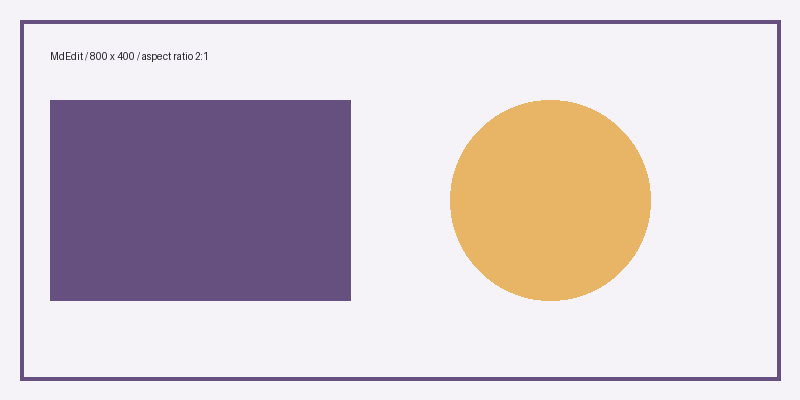
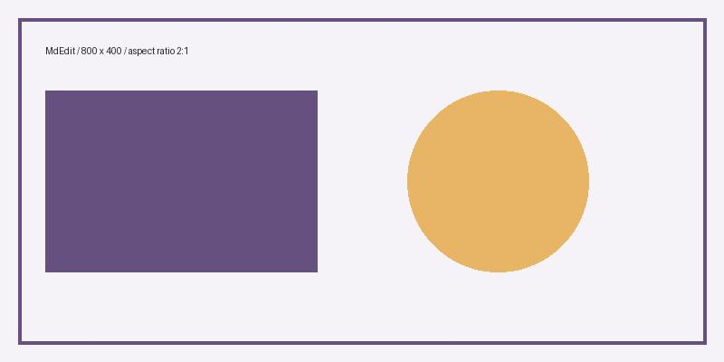
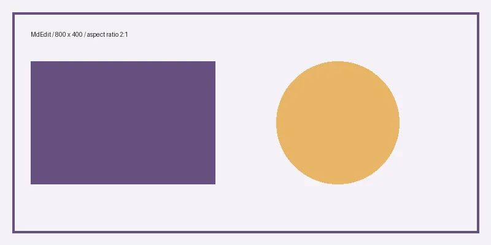

# MdEdit 综合测试

## Markdown 原生表格：正文内编辑

点击单元格即可输入，双击可选择文字。Tab / Shift+Tab 切换单元格，最后一格按 Tab 新增行；右键增删行列和移动表格块。修改会直接同步回标准 Markdown，支持撤销；切换源码模式可核对原生数据。

| 李四 |  | 待验证 |  |
| --- | --- | --- | --- |
| 负责人 |  | 状态 | **的三啊** |
| 张三 |  | 待验证 | 赛sdfsdf赛赛的动 |
| 王五 | 待验证的赛赛赛赛赛赛赛赛的赛动赛赛赛赛赛岽的三的赛赛东的d | 待验证赛动动赛赛点 | 待验证  点点滴滴的的的的的的三三的的的的的动赛的三的三动动的的的的的的的的的的三d的 |
|  |  |  |  |

## 1. 基础文字与行内

普通文字：这是一段中文正文，包含 English、1234567890 和标点：，。！？「」『』（）——。
加粗：**这是一段加粗文字 Bold 123**。
斜体：*这是一段斜体文字 Italic 123*。
加粗斜体：***这是一段加粗斜体文字 Bold Italic 123***。
删除线：~~这是一段删除线文字 Deleted 123~~。
加粗与删除线：~~**这是一段加粗并带删除线的文字**~~。
斜体与删除线：~~*这是一段斜体并带删除线的文字*~~。
加粗斜体与删除线：~~***这是一段加粗斜体并带删除线的文字***~~。
行内代码：`const value = 123;`。
混合样式：普通文字、**加粗**、*斜体*、***加粗斜体***、~~删除线~~、`行内代码`，最后恢复普通文字。

 **的的


**加粗结束后**这里应恢复普通文字。
*斜体结束后*这里应恢复普通文字。
***加粗斜体结束后***这里应恢复普通文字。
~~删除线结束后~~这里应恢复普通文字。

这一行是普通正文。
下一行也是普通正文，用于比较连续文字行的行距。

上方有一个空行，空行应与一行正文占用相同高度。


上方有两个连续空行，用于检查空行高度是否一致。
长行换行测试：当窗口变窄时，这段文字应自动换行，其中的 **加粗文字**、*斜体文字*、***加粗斜体文字*** 和 ~~删除线文字~~ 应保持样式，换行后继续正常显示，编辑和预览均不应丢失内容。

这里使用两个空格结尾产生显式段内换行。  
这一行应在同一段内另起一行显示。

这才是空行分隔的新段落。
特殊字符：& < > " ' © → ∞ α β γ ✅
转义标记：\*不是斜体\*、\*\*不是加粗\*\*、\~\~不是删除线\~\~。

## 2. 六级标题
### 三级标题
#### 四级标题
##### 五级标题
###### 六级标题
标题下面的普通正文不应继承标题格式。

## 3. 列表

- 第一项
- 第二项，包含 **粗体** 和 $a^2+b^2=c^2$
- 包含嵌套列表的一级项目
    - 二级项目
    - 另一个二级项目
        - 三级列表
- 最后一项

1. 打开文件
2. 编辑内容
3. 切换预览
4. 保存并重新打开

- [x] 已完成的任务
- [ ] 未完成的任务
- [ ] 验证公式 $E=mc^2$

## 4. 引用

> 这是一段引用
> 引用内包含 **强调** 和行内公式 $x+y=z$。
>
> > 这是嵌套引用。

引用结束，正文恢复正常。

---

## 5. 表格

| 语法或内容 | 项目 | 结果 |  |  |
| :---: | :--- | ---: | --- | --- |
| **加粗** | 中文 | 123 |  |  |
|  | 行内数学 | 789 |  |  |
|  | 行内代码 | 456 |  |  |
| $\frac{a}{b}$ | 分式 | 0.5 |  |  |

## 6. 链接

[Qt 官方网站](https://www.qt.io/)
[相对路径链接：项目说明](README.md)

图片及其他外部资源测试统一放在文末第 26 节。

## 7. 代码块与转义

行内代码中的美元符号应保持原样：`$E=mc^2$` 和 `$$x+y$$`。
行内代码可以包含单个反引号：``这里有 `反引号` 和 $普通文本$``。

```cpp
#include <iostream>
int main() {
    // 代码中的 $x$ 和 $$x^2$$ 都不应渲染成公式。
    std::cout << "你好，Markdown!" << std::endl;
    return 0;
}
```


```python
def square(x):
    return x ** 2

print([square(x) for x in range(5)])
price = "$100"
```


```latex
% 这一整个代码块都应显示源码。
$\frac{a}{b}$
$$
\int_0^1 x^2\,dx = \frac{1}{3}
$$
```


~~~text
波浪线围栏代码块。
$literal$ 与 $$literal$$ 都不应渲染。
~~~

转义美元符号：\$100、\$x\$、\$\$不应作为公式\$\$。

转义 Markdown 标记：\*星号\*、\#井号、\[方括号\]。

空美元符号测试：$$$$。这里没有公式内容，应保持原样。

## 8. 行内数学公式

普通文字$E=mc^2$普通文字，公式应保持在同一段落内，前后文字不应居中。
变量与下标：$x_i$、$a_{n+1}$、$x^2$、$e^{i\pi}+1=0$。
希腊字母：$\alpha+\beta=\gamma$，$\theta \in [0,2\pi]$。
行内分式：$\frac{a+b}{c+d}$，根号：$\sqrt{x^2+y^2}$，三次根：$\sqrt[3]{8}=2$。

行内求和：$\sum_{i=1}^{n} i$，行内积分：$\int_0^1 x\,dx$。注意与后面独立公式的上下限位置、大小作比较。
同一行多个公式：$a$、$b$、$c$，以及 $a+b=c$。

英文基线比较：Text $x$ text $x_i$ text $x^2$ text $\frac{1}{2}$ text。

中文基线比较：文字 $x$ 文字 $x_i$ 文字 $\frac{1}{2}$ 文字。

## 9. 独立公式：单行写法

下面的公式应单独居中，段落前后留有间距：      我   

$$E=mc^2$$

公式下面的正文应恢复左对齐。

前面的正文 $$a^2+b^2=c^2$$ 后面的正文：即使源码写在同一行，双美元符号公式也应独立成段，前后文字保持左对齐。

## 10. 独立公式：跨行写法

编辑模式中，开始符号、公式内容和结束符号都应高亮。

$$
\frac{a+b}{c+d}=\frac{1}{2}
$$

$$
\int_0^1 x^2\,dx=\frac{1}{3}
$$

$$
\sum_{i=1}^{n} i=\frac{n(n+1)}{2}
$$

$$
\lim_{x\to 0}\frac{\sin x}{x}=1
$$

$$
\sqrt{\frac{x^2+y^2}{1+z^2}}
$$

$$
\left(\frac{a}{b}\right)^2+\left[\frac{c}{d}\right]^2
$$

## 11. 矩阵、分段函数与多行等式

$$
\begin{pmatrix}
a & b \\
c & d
\end{pmatrix}
$$

$$
\begin{bmatrix}
1 & 0 & 0 \\
0 & 1 & 0 \\
0 & 0 & 1
\end{bmatrix}
$$

$$
f(x)=\begin{cases}
x^2 & x\ge 0 \\
-x & x<0
\end{cases}
$$

$$
\begin{aligned}
(a+b)^2 &= a^2+2ab+b^2 \\
(a-b)^2 &= a^2-2ab+b^2
\end{aligned}
$$

## 12. 更多数学符号

$$
\mathbf{v}=\begin{pmatrix}x\\y\\z\end{pmatrix},\qquad
\|\mathbf{v}\|=\sqrt{x^2+y^2+z^2}
$$

$$
A\cup B,\quad A\cap B,\quad x\in A,\quad
A\subseteq B,\quad \forall x,\quad \exists y
$$

$$
\frac{d}{dx}\sin x=\cos x,\qquad
\frac{\partial f}{\partial x}=2x
$$

## 13. 修改与保存检查

1. 在此处输入一段中文和一个公式。
2. 修改一个跨行公式，观察编辑模式下高亮是否更新。
3. 删除再补回公式的结束 `$$`，检查后续正文高亮是否恢复。
4. 离开公式段落查看排版，再按 Ctrl+E 对照全文源码。
5. 缩窄窗口，检查行内公式、表格和长段落。
6. 按 Ctrl+S 保存，再次打开，确认源码仍完整。

测试输入区：

在这里写下内容。

---

## 14. 强调、边界与组合排版

普通文字、**粗体**、*斜体*、***粗斜体***、~~删除线~~、`行内代码`。

相邻标记：**中文粗体**后接正文；*English italic* 与 $x_i$；**粗体中的 `code`**。

下划线样例：_斜体_、__粗体__、file_name_with_underscores。

字面转义：\*\*不是粗体\*\*、\`不是代码\`、\!\[不是图片\]、反斜杠 \\。

实体字符：&amp;、&lt;tag&gt;、&quot;引号&quot;。观察源码与排版的差异，保存后源码应保持原样。

---

***

___

三种分隔线前后均有空行，不应误吞相邻正文。

> ### 引用中的标题
>
> - 引用内列表：**强调**、`code`、$a+b$。
> - 第二项。
>
> 引用结束前的普通段落。

| 左对齐 | 居中 | 右对齐 |
| :--- | :---: | ---: |
| 空单元格见下一行 | **粗体** | 123.45 |
|  | `code` | -0.5 |
| 转义竖线 a\|b | $x_1$ | 10000 |
| 很长的中文单元格用于检查窄窗口中换行、裁切及布局恢复 | 中间 | 9 |
|  |  |  |

验收：当前段落进入源码后能修改，离开后恢复排版；组合内容无重复、缺字或跨段格式污染。删除线、实体及复杂嵌套按实际 Qt Markdown 子集记录兼容性结果。

## 15. Live 编辑与选区映射（P0）

| 编号 | 操作 | 预期结果 |
| --- | --- | --- |
| LIVE-01 | 打开副本，点击普通段落、标题、列表、表格 | 当前区域可编辑源码，离开后恢复相应排版 |
| LIVE-02 | 点击行内公式前后、公式对象及独立公式 | 能进入对应源码区域；输入落点与所选位置一致 |
| LIVE-03 | 点击多行代码块的首行、中间、末行 | 完整围栏区域可编辑；退出后围栏行留空但保留高度 |
| LIVE-04 | 在空行、文首、文末输入，再删除 | 不吞并相邻段落，无残留占位符 |
| LIVE-05 | 从前向后选中跨段内容，Ctrl+E 往返两次 | 选区覆盖相同源码范围，光标端与锚点方向保留 |
| LIVE-06 | 反向选择含公式、粗体和代码的多段内容，再切换模式 | 反向选区保留，标记和内容完整 |
| LIVE-07 | 选中公式前半段或 Markdown 标记的一部分并替换 | 只修改对应源码；离开后重新排版，不崩溃 |
| LIVE-08 | 滚动到文档中后部切换模式，并使用方向键、Home/End | 光标可见且可继续编辑；记录滚动跳动及定位异常 |

重点检查：Live 排版不是源文件内容。复制、保存和切换模式不得把内部图片/公式占位字符写入文件。

## 16. 输入、剪贴板与编辑命令（P0 / P1）

以下操作在两种模式分别执行。每次记录实际源码，使用撤销回到初始状态。

| 编号 | 操作 | 预期结果 |
| --- | --- | --- |
| EDIT-01 | 中文输入法连续输入、候选选择、取消组合，再输入英文 | 无重复提交、缺字；候选阶段不破坏段落映射 |
| EDIT-02 | 输入 emoji、组合字符，再逐次 Backspace/Delete | 字符删除后文档仍可编辑；记录字素边界异常 |
| EDIT-03 | 选择中文、公式和格式标记混合内容，复制到纯文本编辑器 | 得到所选 Markdown 源码，公式和标记完整 |
| EDIT-04 | 无选区 Ctrl+C / Ctrl+X，含末尾无换行的最后一行 | 按源码换行段落复制/剪切；存在的末尾换行包含在内 |
| EDIT-05 | 跨多个渲染区域剪切、粘贴，再撤销和重做 | 文本顺序、标记与位置一致，无区域遗漏 |
| EDIT-06 | 选中文字按 Ctrl+B / Ctrl+I / Ctrl+Shift+C | 分别包裹粗体、斜体、行内代码标记；再次执行检查移除行为 |
| EDIT-07 | 无选区执行上述格式命令并输入文字 | 插入成对标记，光标位于标记之间 |
| EDIT-08 | 选中文字按 Ctrl+K，再修改 url | 插入 `[选区](url)`；源文档可编辑并可撤销 |
| EDIT-09 | 对单行及多行使用 Ctrl+] / Ctrl+[ | 增减 4 空格缩进；选区恰好结束于下一行起点时不修改下一行 |
| EDIT-10 | 无选区 Ctrl+Shift+K，分别位于首行、空行、末行 | 删除当前行，不误删相邻内容；撤销恢复 |
| EDIT-11 | 连续输入、格式操作、剪切、替换后逐次撤销，再重做 | 两模式使用同一源码历史；无文本丢失或异常拼接 |

字符样例：中文输入测试，English 123，😀🚀，é，👨‍👩‍👧‍👦。

格式练习：选中这几个字。第二段用于测试跨段复制与缩进。

第二段练习：**加粗**、`code`、$x^2$。

含反引号的代码包裹需手工选择合适围栏；当前简单包裹命令不承诺自动处理所有嵌套反引号。

## 17. 列表续写与换行（P1）

在 Live 模式逐项测试，源码模式只记录实际换行行为，不把 Live 续写作为源码模式要求。

1. 在无序列表项末尾按 Enter：延续同类列表标记。
2. 在有序列表末尾按 Enter：检查下一项序号；在中间项换行时记录后续编号，不假定自动重排全表。
3. 在已完成任务末尾按 Enter：新任务使用未完成标记 `[ ]`。
4. 在仅有标记的空列表项按 Enter：退出当前列表项，继续输入普通正文。
5. 在嵌套项中换行：检查缩进与标记；使用明确缩进命令调整层级。
6. Shift+Enter：仅插入换行，不自动补列表标记。
7. 在代码围栏或多行公式中按 Enter：仅换行，代码/公式中的 `-`、`1.` 不触发列表续写。
8. 在引用中按 Enter：记录实际行为；引用自动续写目前不作为已实现能力验收。

- 无序练习项

7. 有序练习项

- [x] 已完成练习项
- [ ] 未完成练习项

## 18. 查找与替换（P1）

固定样例：FindToken findtoken FINDTOKEN FindToken。

重复样例：替换样例甲 / 替换样例甲 / 替换样例乙。

字面匹配样例：a.b、a*b、[abc]、$literal$。

| 编号 | 操作 | 预期结果 |
| --- | --- | --- |
| FIND-01 | Ctrl+F 输入 FindToken，执行向前/向后查找 | 定位对应源码；越过首尾后循环查找 |
| FIND-02 | 开关区分大小写 | 开启时只匹配相同大小写；关闭时匹配大小写变体 |
| FIND-03 | 选择单行文字后打开查找 | 选中文字预填到查找框 |
| FIND-04 | 查找不存在的字符串、空字符串 | 不修改文档，不崩溃；记录无匹配反馈 |
| FIND-05 | 查找 a.b、a*b、[abc] | 按字面字符匹配，不按正则解释 |
| FIND-06 | Ctrl+H，查找“替换样例甲”，逐次替换为“替换样例丙” | 仅替换匹配内容，未匹配选区不被误替换 |
| FIND-07 | 全部替换，再撤销 | 所有匹配被替换；撤销恢复替换前内容 |
| FIND-08 | 替换文本为空；替换文本包含搜索串 | 可删除匹配项；不会无限循环或卡住 |
| FIND-09 | 查找公式源码、代码中的美元符号及跨区域重复词 | 匹配基于源码；回到编辑器后选区与位置正确 |
| FIND-10 | 打开/关闭窗口，Tab 切换控件，两种编辑模式往返 | 焦点可恢复，文档仍可正常编辑 |

整词匹配、正则搜索和跨文件搜索目前不列为通过条件。

## 19. 代码语言与围栏边界（P1）

非当前区域检查等宽字体与基础语法高亮；进入后检查源码完整。高亮不要求达到完整语言分析器级别。

```javascript
const message = "中文 $literal$";
// 注释中 **不是粗体**
console.log(message, 42, true);
```

```typescript
interface Item { name: string; done: boolean }
const item: Item = { name: "测试", done: false };
```

```json
{"name": "中文", "count": 2, "enabled": true, "value": null}
```

```sh
# Shell 注释
value="$HOME"
printf '%s\n' "$value"
```

```unknown-language
未知语言不应阻止显示：**literal** $literal$ <tag>
```

```
无语言围栏：保持等宽显示，保留空格与换行。
    四个前导空格
```

````markdown
外层使用四个反引号，内部的三个反引号不应提前结束外层：
```cpp
int value = 42;
```
````

操作：在副本中修改语言标签、删去并补回结束围栏；检查后续段落在补回后恢复正常。分别观察空代码块、仅空白行和较长代码行，不能丢失源码。

## 20. 数学边界、错误恢复与离线渲染（P1）

补充行内样例：$-1$、$x_{i_j}^{n+1}$、$\overline{AB}$、$\vec{v}$、$\hat{x}$、$\sin^2 x+\cos^2 x=1$。

$$
\prod_{k=1}^{n} k=n!,\qquad
\binom{n}{k}=\frac{n!}{k!(n-k)!}
$$

$$
\begin{vmatrix}
a & b \\
c & d
\end{vmatrix}=ad-bc
$$

边界源码样例（先以代码显示；在副本单独输入以触发解析）：

```text
未闭合行内：$x+1
未闭合独立：$$x+1
未知命令：$\thisCommandShouldNotExist{x}$
缺少分组闭合：$\frac{a}{b$
空公式：$$$$
价格与美元：$100、US$20、\$30
```

- 逐项输入错误公式：无法解析时应保留源码，不能崩溃或把后续内容写坏；错误提示按实际预览控件验证。
- 修复错误并离开段落：应能重新渲染，不残留旧公式图像。
- 同段连续修改公式、删除再补回 `$` / `$$`：检查高亮状态和正文对齐恢复。
- 在不连接网络的环境打开正常公式：内置字体和 MicroTeX 资源齐全时仍可排版。
- 窄窗口、长公式、字号变化：记录裁切、行高、基线和横向溢出，源码始终完整。
- 代码中的公式字符串、转义美元、空美元保持字面含义；货币歧义按实际解析记录，不假定所有美元写法均是价格。

## 21. 文件生命周期与保存（P0）

每项使用独立临时副本。通过文本编辑器重新读取磁盘内容核对，不能仅凭界面显示判断保存成功。

| 编号 | 操作 | 预期结果 |
| --- | --- | --- |
| FILE-01 | 启动页“打开”、Ctrl+O、已打开文件后再 Ctrl+O | 可选择现有文件；切换前修改应保存，取消选择保留当前内容 |
| FILE-02 | 使用命令行参数传入含中文、空格的文件路径 | 正确打开目标文件，不误拆路径 |
| FILE-03 | 输入中文、emoji、反斜杠和公式，停止输入至少 1 秒 | 延时自动保存后磁盘内容与源码一致，写出为 UTF-8 |
| FILE-04 | 修改后立即 Ctrl+S | 手动保存无需等待自动保存延时 |
| FILE-05 | 修改后立即正常关闭，再重新打开 | 关闭前保存最后修改，文档内容完整 |
| FILE-06 | 打开空文件、末行无换行文件、仅空白文件 | 可编辑、保存、重新打开，无崩溃或丢字 |
| FILE-07 | 用临时文件观察只读/无写入权限时保存及关闭 | 保存失败有反馈；失败时阻止关闭，仍能查看未保存修改 |
| FILE-08 | 打开不存在或不可读路径 | 显示失败反馈，不破坏当前已打开内容 |
| FILE-09 | 分别打开 UTF-8 无 BOM、有 BOM、LF 和 CRLF 副本 | 记录编码与换行变化；中文、公式及文本语义不得损坏 |

保存基准为 UTF-8 文本内容完整，不默认承诺逐字节保留 BOM 或原始换行编码。外部修改检测和冲突合并尚未实现，避免让另一编辑器同时写入测试文件。异常断电恢复、历史版本和备份不属于当前自动保存保证。

## 22. 设置、布局与可用性（P1）

1. 从顶部“设置”、文件菜单或菜单显示的设置快捷键进入，检查入口可用。
2. 分别设置 9、14、30 pt，检查即时生效；尝试边界外输入，确认值受范围约束。
3. 检查正文、源码、界面、行号和标题比例；代码与公式不重叠，选区点击位置正确。
4. 关闭重启后检查字号保持；执行“恢复默认值”后应恢复 14 pt，再重启核验。
5. 窗口最大化、还原、缩窄，再恢复；检查表格、图片、长行和公式布局重新计算。
6. 在文首、文中、文末快速滚动；点击行号旁与文本区域，检查行号、当前行和光标位置的一致性。
7. 键盘完成打开、查找、替换、设置和返回文档；焦点与菜单快捷键不应相互阻塞。
8. 在可用环境补测 100%、150%、200% 显示缩放及跨屏移动，记录分辨率和缩放设置；未具备环境的项标“不适用”。

## 23. 长文档、重复操作与稳定性（P2）

使用副本生成压力样本，记录字符数、行数、公式/图片数量、设备配置、加载耗时和交互延迟。下列规模是观察档位，不是已承诺的性能指标。

| 样本 | 建议规模 | 观察项 |
| --- | --- | --- |
| 长段落 | 单段约 1 万字符 | 自动换行、点击定位、删除与保存 |
| 多段落 | 约 1000 行，再扩展到 1 万行 | 打开、滚动、行号、查找与模式切换 |
| 密集公式 | 约 100 个正常公式 | 离线排版、编辑重绘、字号变化 |
| 长代码块 | 约 1000 行 | 高亮、围栏边界、光标与选区 |
| 重复编辑 | 连续 50 次切换模式及修改/撤销 | 文本不变、无崩溃，记录内存是否持续异常增长 |

每组结束重新打开文件对照源码；界面流畅但保存内容改变，仍判为失败。不要将无法解析的超大公式当作普通性能基准。

## 24. 未实现能力与兼容性观察（P2）

以下样例仅用于确认源码可保留、编辑器稳定，不要求当前版本提供专用语义或渲染。不把未实现功能记录为已通过功能验收。

```markdown
---
title: YAML 属性样例
tags: [test, 中文]
---
[[双向链接]]
![[嵌入笔记]]
正文脚注[^note]
[^note]: 脚注内容
> [!NOTE] Callout 标题
> 内容
==高亮==
%%注释%%
```

Mermaid 观察样例（当前不要求图形渲染）：


其他待补功能包括只读阅读模式、新建/另存为、文件树、多标签页、外部文件冲突检测、正则查找、插件、PDF 导出。详细范围见 [功能对照](docs/obsidian-behavior-comparison.md)。

## 25. 缺陷记录与结束检查

| 字段 | 填写内容 |
| --- | --- |
| 用例编号 / 状态 | |
| 应用版本或提交 / 操作系统 | |
| 编辑模式 / 字号 / 显示缩放 / 输入法 | |
| 前置条件及最小样例 | |
| 复现步骤 | |
| 预期结果 | |
| 实际结果 / 截图 / 日志 | |
| 源文件是否受损 / 是否可撤销 | |
| 复测结果 | |

- [ ] P0 用例全部执行，失败项均已记录并明确是否阻塞发布。
- [ ] P1 核心操作在两种模式完成；仅 Live 支持项按其范围执行。
- [ ] 缺图、错误公式与未支持语法均不会导致文档损坏或应用崩溃。
- [ ] 保存后重新打开核对中文、格式标记、公式与相对资源路径。
- [ ] 恢复个人字号设置，保留必要的测试副本与缺陷记录。
- [ ] 每个未执行、不适用和待核验项目均有说明；不将本清单当作自动测试报告。

## 26. 外部资源综合测试（集中置于文末）

以下引用均为实际夹具，以本 Markdown 所在目录解析。请保留整个 `assets` 目录；修改 CSV 等资源前先复制测试目录。每个资源检查加载完成后的显示、进入引用源码、移出后恢复、保存与重新打开；资源内容和内部预览占位符不得写入 Markdown。

### 26.1 图片：自动尺寸、指定宽度与行内显示

SVG 自动尺寸，应保持比例：


同一张 800×400 的 PNG，分别按自动尺寸、400×200、200×100 显示：




行内指定宽度：前面的文字  后面的文字。检查离开源码后仍按 200×100 显示。

行内自动尺寸：前面的文字  后面的文字。检查与正文基线的适配。

中文和空格路径（尖括号及百分号编码两种写法）：


无效尺寸 `|0`、`|-1`、`|abc` 应保留为普通说明文字，使用自动尺寸：


### 26.2 图片格式覆盖

仅支持 PNG、SVG、JPG、JPEG、BMP、GIF、WebP、TIF、TIFF。GIF 当前只预览静态帧。其他文件显示单行附件条，点击文件名使用系统默认程序打开。








### 26.3 PDF：分页与打开原文件


第 1 页为紫色，第 2 页为绿色。点击下一页、上一页，核对页码和内容；首尾页不显示越界翻页入口。点击“打开原文件”应交给系统阅读器。切换源码及重新展示时，Markdown 引用保持不变。

### 26.4 CSV：摘要与外部编辑

下面的表格来自独立 CSV 文件。Live 模式下显示只读表格摘要；光标移入资源区域时可编辑 Markdown 引用，移出后恢复表格；切换时保留表格占用高度，避免页面上移。CSV 文件内容不写入 Markdown 正文。


表格操作：双击打开编辑面板，可编辑单元格、在当前行列前后插入、删除、调整行列顺序；点击“应用”保存，或“取消”放弃修改。CSV 保存到独立文件。右键表格可上移、下移整个引用块；Markdown 表格同样支持这些操作，修改正文后可撤销。编辑菜单提供“插入表格”。

可观察：展示时以“工程材料统计”为标题，隐藏引用语法和路径；表格包含中文表头、数量与价格、包含逗号的备注，以及带双引号的样品编号。最多显示前 8 行、8 列。

### 26.5 文本：所有支持的扩展名

以下均显示原始文本摘要。HTML、Markdown、代码、公式标记不应执行或解释；TSV 按文本显示，CSV 的表格行为见上一节。每个资源都有标题和“打开原文件”。


### 26.6 文本编码、边界与截断

普通 UTF-8 已由上面的中文 TXT 覆盖。以下带 BOM 的编码均应正确显示“中文编码测试 / English / 😀”和第二行，不出现乱码或 BOM 字符：


空文件应明确显示“空文本文件”，不当成加载中或错误：


长日志最多取前 12 行，超过预览范围显示省略提示；超宽行以省略号裁切。打开原文件可核对全文：


### 26.7 异常资源（预期显示错误）

下列项目故意无效。应显示可理解的错误，不崩溃，不影响相邻正文和源码：


32 MiB 上限、超过 1 亿像素的图片、加密 PDF 和文件读取权限错误使用临时副本补测，不在仓库加入超大或依赖系统权限的夹具；未执行时标记“未执行”。Word、Excel 工作簿、音视频、DXF、GLB 等当前未接入，不列为应显示成功的资源。

### 26.8 路径、链接与通用验收

| 编号 | 操作 | 预期结果 |  |
| --- | --- | --- | --- |
| RES-01 | 打开本节本地 SVG，缩窄/放大窗口 | 图片可显示，比例合理，前后文字完整 |  |
| RES-02 | 将测试目录移到含中文与空格的路径再打开 | 相对资源仍以文档目录解析 |  |
| RES-03 | 打开故意不存在的图片 | 不崩溃；记录缺图反馈，源码路径和替代文字保留 |  |
| RES-04 | 离线打开含外部链接的文档 | 本地文字、图片和公式仍可用 |  |
| RES-05 | 在副本添加有效页内锚点并点击 | 检查实际导航位置；源文档不改变 |  |
| RES-06 | 手动点击 HTTP(S) 链接 | 检查允许链接的打开行为；仅在希望访问时执行 |  |
| RES-07 | 点击 README.md 相对链接 | 当前本地 Markdown 跳转待补，记录表现，不要求打开新文档 |  |


检查每类资源加载后的正文没有重复、缺字；进入和离开引用源码、Ctrl+E 往返、撤销重做与保存重新打开均保留原引用。缩窄窗口、调整字号后复查布局。以上为手工验收用例，夹具能够读取不等于全部交互已通过。

资源测试结束后的正文：这一行必须能显示、定位、编辑和保存。

**测试结束。**
